# Матеріальна частина зброї — розділ IV

Об’єднаний блок: 458 запитань і відповідей. Повтори під різними номерами збережено. Фото, схеми та таблиці розміщені біля відповідних запитань; №306 доповнено повним зображенням і відповіддю.

[Завантажити весь блок одним ZIP](../Materialna_chastyna_zbroi_IV_1-458.zip) · [Версія TXT](pytannia_1-458.txt) · [HTML з усіма фото всередині](pytannia_z_foto.html)

### 1. Забійна сила кулі пістолета "Форт - 12" зберігається?

**Відповідь:** до 350 м

### 2. Із скількох основних частин складається "Форт - 12"?

**Відповідь:** 7

### 3. Яка відстань найбільш ефективного вогню з пістолета "Форт - 12"?

**Відповідь:** до 50 м

### 4. Яка з перелічених частин "Форт - 12" входить до складу ударно-спускового механізму?

**Відповідь:** Курок

### 5. Який калібр ствола пістолета "Форт -12"?

**Відповідь:** 9 мм

### 6. Яка початкова швидкість польоту кулі пістолета "Форт - 12"?

**Відповідь:** 320 м/с

### 7. Яка бойова скорострільність пістолета "Форт - 12"?

**Відповідь:** 40 постр/хв

### 8. Бойова скорострільність пістолета "Форт - 12":

**Відповідь:** 40 пострілів/хв

### 9. Вага пістолета "Форт - 12" з порожнім магазином?

**Відповідь:** 830 гр

### 10. Вага пістолета "Форт - 12" зі спорядженим магазином:

**Відповідь:** 950 гр

### 11. Відстань найбільш ефективного вогню пістолета "Форт - 12" до:

**Відповідь:** 50 м

### 12. До складу пістолета "Форт - 12" входять:

**Відповідь:** рамка в зборі із стволом, затвор, затворна затримка, направляюча вісь, зворотна пружина, магазин

### 13. Довжина ствола пістолета "Форт - 12":

**Відповідь:** 95 мм

### 14. Кількість нарізів у стволі пістолета "Форт - 12"?

**Відповідь:** 6

### 15. Початкова швидкість пулі пістолета "Форт - 12":

**Відповідь:** 315 м/сек

### 16. У магазин пістолета "Форт - 12" вміщується:

**Відповідь:** 12 патронів

### 17. Відстань найбільш ефективного вогню, початкова швидкість польоту кулі для пістолета Форт - 12:

**Відповідь:** ефективний вогонь - 50 м; початкова швидкість - 315 м/с

### 18. Відстань найбільш ефективного вогню, убивча сила кулі, швидкострільність для Форт - 12:

**Відповідь:** ефективний вогонь - 50 м; убивча сила - 350 м; швидкострільність - 40 постр./хв

### 19. Вкажіть яким способом усувається затримка при стрільбі у пістолета Форт - 12 "Недокриття патрона затвором":

**Відповідь:** поштовхом дослати затвор вперед рукою і продовжити стрільбу

### 20. Вкажіть яким способом усувається затримка при стрільбі у пістолета Форт - 12 "Осічка":

**Відповідь:** перезарядити пістолет і продовжити стрільбу

### 21. До складу яких основних частин чи механізмів пістолета "Форт - 12" входить ударник?

**Відповідь:** Затвору

### 22. До складу якої основної частини пістолета "Форт - 12" входить спускова скоба?

**Відповідь:** Рамки пістолета

### 23. До якої відстані зберігається вбивча сила кулі пістолета "Форт - 12"?

**Відповідь:** До 350 м

### 24. Ємність магазину пістолета Форт - 12 та його калібр:

**Відповідь:** вірна відповідь не вказана

### 25. З яких основних частин складається пістолет "Форт - 12"?

**Відповідь:** Затвор з ударником викидачем і запобіжником; затворна затримка, направляюча вісь та повертаючі (зворотні) пружини; рамка зі стволом; ударно-спусковий механізм; рукоятка; магазин

### 26. Калібр пістолета Форт - 12:

**Відповідь:** 9 мм

### 27. Кількість нарізів в стволі у пістолета Форт - 12 та його калібр:

**Відповідь:** вірна відповідь не вказана

### 28. Кількість нарізів у каналі ствола пістолета Форт - 12 та його патрон:

**Відповідь:** нарізів - 6; патрон - 9х18

### 29. Місце знаходження викидача на пістолеті Форт - 12:

**Відповідь:** затвор

### 30. Місце знаходження спускової скоби на пістолеті Форт - 12:

**Відповідь:** рамка пістолета

### 31. Призначення ствола пістолета Форт - 12:

**Відповідь:** скерування польоту кулі і надання їй обертового руху навколо своєї осі

### 32. Що входить до основної частини пістолета Форт - 12?

**Відповідь:** магазин

### 33. Як усувається затримка "Недокриття патрона затвором" при стрільбі з пістолета Форт - 12?

**Відповідь:** Необхідно поштовхом дослати затвор вперед рукою і продовжити стрільбу

### 34. Яка бойова швидкострільність пістолета "Форт - 12"?

**Відповідь:** 40 постр./хв

### 35. Яка вага пістолета "Форт - 12" зі спорядженим магазином?

**Відповідь:** 950 гр

### 36. Яка деталь пістолета Форт - 12 входить до основних частин пістолета?

**Відповідь:** вірна відповідь не вказана

### 37. Яка деталь пістолета Форт - 12 входить до основних частин пістолета?

**Відповідь:** затвор з ударником, викидачем і запобіжником

### 38. Яка деталь пістолета Форт - 12 входить до основних частин пістолета?

**Відповідь:** ударно-спусковий механізм

### 39. Яка довжина пістолета "Форт - 12"?

**Відповідь:** 180 мм

### 40. Яка кількість нарізів у стволі пістолета "Форт - 12"?

**Відповідь:** 6

### 41. Яка місткість магазина пістолета "Форт - 12"?

**Відповідь:** 12 патронів

### 42. Яка початкова швидкість кулі пістолета "Форт - 12"?

**Відповідь:** 315 м/сек

### 43. Який калібр пістолетів Макарова та "Форт - 12"?

**Відповідь:** 9 мм

### 44. Яким способом усувається затримка "Осічка" при стрільбі з пістолета Форт - 12?

**Відповідь:** Необхідно перезарядити пістолет та провести повторний спуск курка

### 45. Яка деталь пістолета Форт - 12 входить до основних частин пістолета?

**Відповідь:** затворна затримка

### 46. Яка деталь пістолета Форт - 12 входить до основних частин пістолета?

**Відповідь:** Рамка в зборі зі стволом

### 47. Вага пістолета "Форт - 17" з пустим магазином:

**Відповідь:** 680 г

### 48. Вага пістолета "Форт - 17" з спорядженим магазином:

**Відповідь:** 830 г

### 49. До чого відноситься спусковий гачок в Форт - 17?

**Відповідь:** До частин ударно-спускового механізму

### 50. Довжина ствола пістолета "Форт 17":

**Відповідь:** 95 мм

### 51. Загальна висота пістолета "Форт 17":

**Відповідь:** 130 мм

### 52. Загальна довжина пістолета "Форт 17":

**Відповідь:** 180 мм

### 53. Загальна ширина пістолета "Форт 17":

**Відповідь:** 33 мм

### 54. Кількість нарізів в стволі у пістолета Форт - 17 та які:

**Відповідь:** 6 нарізів; калібр - правосторонні

### 55. Кількість нарізів ствола пістолета "Форт 17":

**Відповідь:** 6 шт

### 56. Місце знаходження спускової скоби на пістолеті Форт - 17:

**Відповідь:** рамка пістолета

### 57. На якому принципі заснована робота автоматики пістолета Форт - 17?

**Відповідь:** принципі вільного затвору

### 58. Не є основною частиною пістолета Форт - 17:

**Відповідь:** зворотна вісь

### 59. Пістолет Форт - 17 має ударно-спусковий механізм:

**Відповідь:** Одинарної та подвійної дії

### 60. Практична швидкострільність пістолета Форт - 17 пострілів за хвилину:

**Відповідь:** 40

### 61. Прицільна дальність стрільби з пістолета "Форт 17":

**Відповідь:** 25 м

### 62. Ствол пістолета Форт - 17 призначений для:

**Відповідь:** Для направлення польоту кулі

### 63. Ударник пістолета Форт - 17 призначений для:

**Відповідь:** Для розбивання капсулю патрона

### 64. Функції затвору Форт - 17:

**Відповідь:** ставить курок на бойовий взвід

### 65. Що є одною з основних частин Форт - 17?

**Відповідь:** Затворна затримка

### 66. Що служить для зведення курка при натисканні на хвіст спускового гачка Форт - 17?

**Відповідь:** спускова тяга

### 67. Яка деталь пістолета Форт - 17 входить до УСМ?

**Відповідь:** спусковий гачок

### 68. Яка основна відмінність між пістолетом "Форт - 12" та "Форт - 17"?

**Відповідь:** різна місткість магазину

### 69. Який калібр пістолета "Форт - 17"?

**Відповідь:** 9 мм

### 70. Місткість магазина пістолета "Форт - 17" з патронами "9 mm Makarov":

**Відповідь:** 15 шт

### 71. Затворна затримка пістолета Форт - 17 призначена для:

**Відповідь:** Для утримання затвору в задньому положенні після використання всіх патронів з магазину

### 72. До складу чого відноситься засувка бойової пружини ПМ?

**Відповідь:** Ударно-спускового механізму

### 73. Що служить для утримання курка на бойовому та запобіжному зводі в ПМ?

**Відповідь:** Шептало

### 74. Для чого здійснюється неповне розбирання ПМ?

**Відповідь:** Чищення, змащення та огляду пістолета

### 75. Яка початкова швидкість польоту кулі пістолета Макарова?

**Відповідь:** 315 м/с

### 76. Яку затримку при стрільбі спричинює торкання полички уступу запобіжника зуба шептала ПМ?

**Відповідь:** Автоматична стрільба

### 77. За рахунок чого забезпечується надійність запирання каналу ствола у ПМ?

**Відповідь:** за рахунок маси затвора та сили зворотної пружини

### 78. Що служить для приведення в дію курка, важеля взводу та спускової тяги ПМ?

**Відповідь:** Бойова пружина

### 79. Викидач ПМ служить для:

**Відповідь:** Утримання патрону в чашечці затвору до зустрічі з відбивачем

### 80. До якої затримки при стрільбі призводить зношення бойового взводу курка або носика шептала ПМ?

**Відповідь:** Автоматична стрільба

### 81. Яка відстань найбільш ефективного вогню з пістолета Макарова?

**Відповідь:** до 50 м

### 82. На якому принципі основана робота автоматики ПМ?

**Відповідь:** Віддачі вільного затвора

### 83. Для чого здійснюється повне розбирання пістолета ПМ?

**Відповідь:** Зазначене в пунктах 2 та 3 (Чищення при сильному забрудненні пістолета, після знаходження його під дощем чи в снігу; При переході на нове мастило, а також при ремонті)

### 84. Яка бойова скорострільність пістолета Макарова?

**Відповідь:** 30 постр/хв

### 85. Що призначено для розбивання капсуля патрона в ПМ?

**Відповідь:** Ударник

### 86. Що служить для запобігання від випадкового натискання на хвіст спускового гачка в ПМ?

**Відповідь:** Спускова скоба

### 87. До складу чого відноситься бойова пружина у ПМ?

**Відповідь:** Ударно-спускового механізму

### 88. Яка з перелічених частин входить до складу затвору ПМ?

**Відповідь:** Пружина викидача

### 89. Яка частина ПМ служить для утримання гільзи (патрона) в чашечці затвора до зустрічі з відбивачем?

**Відповідь:** Викидач

### 90. Бойова пружина в ПМ служить для приведення в дію:

**Відповідь:** Курка, важеля зводу спускової тяги

### 91. Викидач в ПМ служить для:

**Відповідь:** Утримання гільзи в чашечці затвора до зустрічі з відбивачем

### 92. Відстань найбільш ефективного вогню ПМ до:

**Відповідь:** 50 м

### 93. До частин ударно-спускового механізму ПМ належать:

**Відповідь:** Спусковий гачок, спускова тяга з важелем зводу, шептало з пружиною, курок, бойова пружина, засувка бойової пружини

### 94. До чого призводить згущення мастила або забруднення каналу для ударника при стрільбі з пістолета Макарова?

**Відповідь:** Осічки

### 95. Довжина ствола ПМ:

**Відповідь:** 93 мм

### 96. З яких частин складається магазин ПМ:

**Відповідь:** Корпус магазина, подавач, кришка магазина, пружина подавача

### 97. Магазин в ПМ служить для:

**Відповідь:** Вміщення 8-ми патронів

### 98. ПМ складається з:

**Відповідь:** Рамки, затвора, зворотної пружини, рукоятки з гвинтом, затворної затримки, ударно-спускового механізму, магазину

### 99. Повне розбирання ПМ проводиться після:

**Відповідь:** Сильного забруднення

### 100. Порядок неповного розбирання пм:

**Відповідь:** від'єднати магазин та оглянути патронник, від'єднати затвор від рамки, зняти зі ствола зворотну пружину

### 101. Призначення бойової пружини пм:

**Відповідь:** служить для приведення в дію курка, важеля зводу та спускової тяги і для утримання магазина в рукоятці

### 102. Призначення затвора з ударником, запобіжником та викидачем ПМ:

**Відповідь:** служить для подачі патрона з магазина до патронника, запирання каналу ствола, утримування (виштовхування) патрона, для поставлення курка на бойовий звід

### 103. Призначення затворної затримки ПМ:

**Відповідь:** утримує затвор у задньому положенні після використання всіх патронів із магазина і для відображення гільз

### 104. Призначення зворотної пружини пм:

**Відповідь:** зворотна пружина служить для повернення в переднє положення затвора після пострілу

### 105. Призначення курка ПМ:

**Відповідь:** служить для завдання удару по ударнику

### 106. Призначення рукоятки пістолета пм:

**Відповідь:** служить для зручного утримання пістолета в руці, прикриває бокові вікна та задню стінку основи рукоятки

### 107. Призначення спускової скоби пм:

**Відповідь:** служить для запобігання випадковому натискуванню на спусковий гачок

### 108. Призначення ствола пістолета пм:

**Відповідь:** служить для спрямування польоту кулі

### 109. Призначення шептала з пружиною ПМ:

**Відповідь:** служить для утримання курка на бойовому або запобіжному зводі

### 110. Чим досягається надійність запирання каналу ствола при пострілі з ПМ?

**Відповідь:** Великою масою затвора та силою зворотної пружини

### 111. Що в пістолеті Макарова служить відбивачем?

**Відповідь:** Верхній кінець затворної затримки

### 112. Що служить для спуска курка з бойового зводу та зведення курка при натисканні на хвіст спускового гачка ПМ?

**Відповідь:** Спускова тяга з важелем зводу

### 113. Яка затримка при стрільбі виникає при забрудненні магазина і рухомих частин ПМ?

**Відповідь:** Неподача або непросування патрона з магазина до патронника

### 114. Яку затримку при стрільбі з ПМ може викликати забруднення патронника або чашечки затвора?

**Відповідь:** Недокриття патрона затвором

### 115. Яку затримку при стрільбі з ПМ спричинює несправність викидача, його пружини або відбивача?

**Відповідь:** Прихват (защемлення) гільзи затвором

### 116. Яку затримку при стрільбі спричинює забруднення рухомих частин пістолета ПМ?

**Відповідь:** Прихвачення (защемлення) гільзи затвором

### 117. До складу чого відноситься викидач в ПМ?

**Відповідь:** Затвору

### 118. До складу основних частин та механізмів пістолета ПМ входить затвор з:

**Відповідь:** Ударником, викидачем та запобіжником

### 119. До складу чого відноситься ударник в будові ПМ?

**Відповідь:** затвору

### 120. На якому принципі основана робота автоматики пістолета ПМ?

**Відповідь:** віддачі вільного затвора

### 121. Чим досягається надійність запирання каналу ствола при пострілі з пістолета ПМ?

**Відповідь:** великою масою затвора та силою зворотньої пружини

### 122. Що спричинює при стрільбі з ПМ послаблення або злам пружини шептала?

**Відповідь:** автоматичну стрільбу

### 123. Яка вага кулі 9 мм патрона до пістолета ПМ?

**Відповідь:** 6,1 гр

### 124. Яка затримка виникає при стрільбі з ПМ внаслідок тяжкого руху викидача через забруднення пружини викидача або гнітка?

**Відповідь:** Прихвачення (защемлення) гільзи затвором

### 125. 9-мм пістолет Макарова є особистою зброєю (закінчіть речення):

**Відповідь:** Нападу та захисту, призначеною для поразки противника на невеликих відстанях

### 126. Для чого призначена бойова пружина пістолета Макарова?

**Відповідь:** Для приведення в дію курка і спускової тяги з важелем зведення

### 127. Для чого призначена рукоятка з гвинтом пістолета Макарова?

**Відповідь:** Для прикривання бокових вікон та задньої стінки основи рукоятки

### 128. Для чого призначена спускова тяга з важелем зведення пістолета Макарова?

**Відповідь:** Для спуску курка з бойового зводу і зведення курка при натисканні на хвіст спускового гачка

### 129. Для чого призначене шептало з пружиною у пістолеті Макарова?

**Відповідь:** Для утримання курка на бойовому та запобіжному зводі

### 130. Для чого призначений затвор пістолета Макарова?

**Відповідь:** Для подачі патрона з магазина в патронник; щільного запирання каналу ствола; утримання гільзи; постановки курка на бойовий звід

### 131. Для чого призначений зуб подавача магазина у пістолета Макарова?

**Відповідь:** Для приведення в дію затворної затримки

### 132. Для чого призначений курок пістолета Макарова?

**Відповідь:** Для нанесення удару по ударнику

### 133. До чого може призвести згущення мастила або забруднення каналу ударника пістолета Макарова?

**Відповідь:** До осічки

### 134. До чого може призвести послаблення або виведення з ладу пружини шептала при стрільбі з пістолета Макарова?

**Відповідь:** До автоматичної стрільби

### 135. До якої відстані зберігається вбивча сила кулі пістолета Макарова?

**Відповідь:** До 350 м

### 136. З яких основних частин складається пістолет Макарова?

**Відповідь:** Рамка зі стволом і спусковою скобою; затвор з ударником, викидачем і запобіжником; повертаюча (зворотня) пружина; ударно-спусковий механізм; рукоятка з гвинтом; затворна затримка; магазин

### 137. З якою метою зверху на затворі пістолета Макарова від цілика до мушки зроблено насічку?

**Відповідь:** Для уникнення відблиску світла в око стрільця при прицілюванні

### 138. Яка будова 9 мм патрона пістолета Макарова?

**Відповідь:** Гільза, капсуль, пороховий заряд, куля

### 139. Яка затримка при стрільбі виникає при зношені бойового зводу курка або виведенні з ладу пружини шептала пістолета Макарова?

**Відповідь:** Автоматична стрільба

### 140. Яка місткість магазина пістолета Макарова?

**Відповідь:** 8 патронів

### 141. Яка початкова швидкість кулі пістолета Макарова?

**Відповідь:** 315 м/сек

### 142. Яка частина пістолета Макарова призначена для приведення в дію курка і спускової тяги з важелем зведенням?

**Відповідь:** Бойова пружина

### 143. Які частини входять до складу ударно-спускового механізму пістолет Макарова?

**Відповідь:** Спусковий гачок, курок, бойова пружина, засувка бойової пружини, шептало з пружиною, спускова тяга з важелем зведення

### 144. Яку затримку при стрільбі з пістолета Макарова спричинює забруднення магазина і рухомих частин пістолета?

**Відповідь:** Неподання патрона в патронник

### 145. Забійна сила кулі автомата Калашникова (АК-74)?

**Відповідь:** до 1350 м

### 146. Який калібр ствола АКС-74У?

**Відповідь:** 5,45 мм

### 147. Прицільна дальність автомата Калашникова (АКС-74У)?

**Відповідь:** 500 м

### 148. Газова трубка АКС-74У служить для:

**Відповідь:** направлення руху газового поршня

### 149. Газова трубка АКС-74У служить для:

**Відповідь:** направлення руху газового поршня

### 150. Забійна сила кулі автомата Калашникова (АКС-74У) зберігається?

**Відповідь:** до 1100 м

### 151. Для чого служить затвор АКС-74У?

**Відповідь:** Вірно у всіх випадках (Для досилання патрона в патронник; Розбивання капсуля; Викидання з патронника гільзи)

### 152. Ударно-спусковий механізм АКС-74У служить для:

**Відповідь:** Вірно у всіх пунктах (Спуску курка з бойового взводу або зводу автоспуску; Завдання удару по ударнику; Забезпечення автоматичного або поодинокого вогню, припинення стрільби та установлення автомата на запобіжник)

### 153. Автоматика АКС-74У закладена на:

**Відповідь:** використанні енергії порохових газів, що відводяться з каналу ствола до газової камери

### 154. Бойова скорострільність АКС-74У при стрільбі чергами:

**Відповідь:** 100 пострілів/хв

### 155. Дальність прямого пострілу АКС-74У по грудній фігурі:

**Відповідь:** 360 м

### 156. Довжина прицільної лінії АКС-74У:

**Відповідь:** 235мм

### 157. Довжина ствола АКС-74У:

**Відповідь:** 206,5 мм

### 158. Затвор АКС-74У складається:

**Відповідь:** остов затвору, ударник, викидач

### 159. Затримка при стрільбі з АКС-74У "втикання патрону" виникає з причини:

**Відповідь:** несправність магазину

### 160. Затримка при стрільбі з АКС-74У- "осічка" виникає з причин:

**Відповідь:** всі відповіді вірні (заклинення ударника в затворі; несправність патрона; несправність ударника або ударно-спускового механізму)

### 161. Зворотній механізм АКС-74У складається:

**Відповідь:** зворотна пружина, направляючий стержень, рухомий стержень, муфта

### 162. Калібр АКС-74У:

**Відповідь:** 5,45мм

### 163. Кришка ствольної коробки АКС-74У служить для:

**Відповідь:** для зберігання від забруднення частин і механізмів

### 164. Магазин АКС-74У містить:

**Відповідь:** 30 патронів

### 165. Магазин АКС-74У служить для:

**Відповідь:** розміщення 30 патронів та подачі їх у ствольну коробку

### 166. Прицільна дальність АКС-74У:

**Відповідь:** 500 м

### 167. Ствол АКС-74У має:

**Відповідь:** канал з 4 нарізами

### 168. Ствольна коробка АКС-74У служить:

**Відповідь:** для з'єднання частин і механізмів

### 169. Ствольна накладка АКС-74У служить для:

**Відповідь:** охороняє руки автоматника від опіків при стрільбі

### 170. Темп стрільби АКС-74У:

**Відповідь:** 650-700 пострілів/хв

### 171. Шептало одиночного вогню АКС-74У служить для:

**Відповідь:** утримання курка після пострілу в крайньому задньому положенні, якщо при веденні одиночного вогню спусковий гачок не був відпущений

### 172. 5,45-мм автомат Калашникова є індивідуальною зброєю і призначений для (закінчіть речення):

**Відповідь:** Знищення живої сили та ураження вогневих засобів противника

### 173. Для чого призначена затворна рама з газовим поршнем АКС-74У?

**Відповідь:** Для приведення в дію затвору та ударно-спускового механізму

### 174. Для чого призначена кришка ствольної коробки АКС-74У?

**Відповідь:** Для запобігання забруднення частин і механізмів, поміщених у ствольну коробку

### 175. Для чого призначена ствольна коробка АКС-74У?

**Відповідь:** Усі відповіді вірні (Для забезпечення закривання каналу ствола затвором; Для запирання затвора; Для з'єднання частин і механізмів автомата)

### 176. Для чого призначена цівка АКС-74У?

**Відповідь:** Для зручності дій з автоматом та для запобігання від опіків при стрільбі

### 177. Для чого призначене шептало одиночного вогню АКС-74У?

**Відповідь:** Для утримання курка після пострілу в крайньому задньому положенні, якщо при веденні одиночного вогню спусковий гачок не був відпущений

### 178. Для чого призначений курок з бойовою пружиною АКС-74У?

**Відповідь:** Для нанесення удар по ударнику

### 179. Для чого призначений магазин АКС-74У?

**Відповідь:** Для розміщення патронів та подачі їх у ствольну коробку

### 180. Для чого призначений перевідник АКС-74У?

**Відповідь:** Для перемикання автомата на одиночний або автоматичний вогонь, а також на запобіжник

### 181. Для чого призначений полум'ягасник в АКС-74У?

**Відповідь:** Для зменшення полум'я та величини звуку при пострілі

### 182. Для чого призначений ствол АКС-74У?

**Відповідь:** Для направлення польоту кулі

### 183. Для чого призначений ударно-спусковий механізм АКС-74У?

**Відповідь:** Усі відповіді вірні (Для забезпечення ведення автоматичного чи одиночного вогню, припинення стрільби, для попередження пострілів при незакритому затворі та для постановки автомата на запобіжник; Для нанесення удару по ударнику; Для спуску курка з бойового зводу або із зводу автоспуску)

### 184. Для чого призначені приклад і пістолетна рукоятка АКС-74У?

**Відповідь:** Для зручності дій з автоматом при стрільбі

### 185. До якої відстані зберігається вбивча сила кулі АКС-74У?

**Відповідь:** До 1100 м

### 186. Яка бойова скорострільність одиночними пострілами АКС-74У?

**Відповідь:** 40 постр./хв

### 187. Яка дальність польоту кулі АКС-74У?

**Відповідь:** До 2900 м

### 188. Яка місткість магазину АКС-74У?

**Відповідь:** 30 патронів

### 189. Яка початкова швидкість кулі АКС-74У?

**Відповідь:** 735 м/сек

### 190. Яка прицільна дальність стрільби з АКС-74У? Прицільна дальність автомата Калашникова (АКС-74У):

**Відповідь:** 500 м

### 191. Яка причина затримки "Невитягнення гільзи" при стрільбі з автомата Калашникова?

**Відповідь:** Забруднення патрона

### 192. Яка причина затримки "Неподання патрона" при стрільбі з автомата Калашникова?

**Відповідь:** Забруднення чи несправність магазина

### 193. Яка причина затримки "Осічка" при стрільбі з автомата Калашникова?

**Відповідь:** Несправність патрона

### 194. Яка причина затримки "Утикання патрона" при стрільбі з автомата Калашникова?

**Відповідь:** Погнутість загинів бічних стінок магазину

### 195. Який калібр у АКС-74У?

**Відповідь:** 5,45 мм

### 196. Яким способом усувається затримка "Осічка" при стрільбі з автомата Калашникова?

**Відповідь:** Необхідно перезарядити автомат та провести повторний спуск курка

### 197. Які частини входять до складу затвору АКС-74У?

**Відповідь:** Остов затвору, ударник, викидач з пружиною і віссю, шпилька

### 198. Які частини входять до складу повертаючого (зворотного) механізму АКС-74У?

**Відповідь:** Повертаюча (зворотня) пружина, направляючий стержень, рухомий стержень, муфта

### 199. Які частини входять до складу ударно-спускового механізму АКС-74У?

**Відповідь:** Курок з бойовою пружиною, спусковий гачок, шептало одиночного вогню, пружина автоспуска; перевідник та обмежувач повороту курка

### 200. Максимальна прицільна стрільба з ГП-25 до?

**Відповідь:** 400 м

### 201. Для чого призначений підствольний гранатомет ГП-25?

**Відповідь:** Для боротьби з відкритою живою силою, а також ураження цілей, що знаходяться у легких укриттях, відкритих окопах, траншеях розташованих на відстані від 50 до 400 метрів

### 202. Ємність магазину пістолета-кулемета МР5 А3?

**Відповідь:** 30 патронів

### 203. З яких деталей складається магазин пістолета-кулемета МР5 А3?

**Відповідь:** корпус магазина, подавач, пружина магазина, обмежувальна пластина, кришка магазину

### 204. Скільки нарізів в стволі пістолета-кулемета МР5 А3?

**Відповідь:** 6

### 205. Яка довжина ствола пістолета-кулемета МР5 А3?

**Відповідь:** 225 мм

### 206. Яка маса пістолета-кулемета МР5 А3, без магазину?

**Відповідь:** 3025 гр

### 207. Яка початкова швидкість кулі пістолета-кулемета МР5 А3?

**Відповідь:** 350 м/сек

### 208. Яка довжина пістолета-кулемета МР5 А3 з відкритим прикладом?

**Відповідь:** 690 мм

### 209. До чого відноситься шептало з пружиною?

**Відповідь:** До ударно-спускового механізму

### 210. Ударник входить до складу:

**Відповідь:** Затвора

### 211. Що призначено для утримання затвору в крайньому задньому положенні по закінченні всіх патронів в магазині?

**Відповідь:** Затворна затримка

### 212. Яку затримку викликає ослаблення чи злам пружини шептала?

**Відповідь:** Автоматична стрільба

### 213. Яку затримку при стрільбі може викликати погнутість верхніх стінок корпусу магазина?

**Відповідь:** Непросування патрона з магазина в патронник

### 214. До складу чого відноситься викидач?

**Відповідь:** затвору

### 215. До складу чого відноситься спусковий гачок?

**Відповідь:** Ударно-спускового механізму

### 216. Що служить для приведення в дію курка, важеля зводу та спускової тяги?

**Відповідь:** бойова пружина

### 217. Що служить для утримання гільзи (патрона) чашечці до зустрічі з відбивачем?

**Відповідь:** викидач

### 218. Яка затримка при стрільбі виникає при несправному капсулі патрона?

**Відповідь:** Осічка

### 219. Яка затримка при стрільбі виникає при погнутості верхніх країв корпуса магазина?

**Відповідь:** Неподача або непросування патрона з магазина до патронника

### 220. Яка затримка при стрільбі виникає при погнутості верхніх країв корпуса магазина?

**Відповідь:** Неподача або непросування патрона з магазина до патронника

### 221. Для усунення затримки при стрільбі "Недосилання патрону затвором" викликаної забрудненням патронника або викидача необхідно:

**Відповідь:** Дослати затвор рукою вперед і продовжити стрільбу

### 222. Для чого призначена антапка в пістолеті?

**Відповідь:** Для кріплення карабінчика з пістолетним ремінцем

### 223. Для чого призначена кобура пістолета?

**Відповідь:** Для носіння і зберігання пістолета, запасного магазина і протирки

### 224. Для чого призначена спускова скоба пістолета?

**Відповідь:** Для запобігання випадковому натисненню на хвіст спускового гачка

### 225. Для чого призначений магазин пістолета?

**Відповідь:** Для розміщення патронів

### 226. Для чого призначений ствол пістолета?

**Відповідь:** Для направлення польоту кулі

### 227. Для чого призначений ударник пістолета?

**Відповідь:** Для розбивання капсуля патрона

### 228. Для чого призначений цілик з мушкою пістолета?

**Відповідь:** Для прицілювання

### 229. До якого виду затримок може призвести злам бойового виступу курка або шептала?

**Відповідь:** Відбувається автоматична стрільба

### 230. З яких основних частин і механізмів складається автомат?

**Відповідь:** Ствол зі ствольною коробкою, прицільним пристроєм, прикладом і пістолетною рукояткою; кришка ствольної коробки; затворна рама з газовим поршнем; затвор; зворотній механізм; газова трубка зі ствольною накладкою; ударно-спусковий механізм; ців'я; магазин; дульне гальмо-компенсатор

### 231. З яких частин складається 9-мм пістолетний патрон?

**Відповідь:** Гільза, капсуль, пороховий заряд, куля

### 232. Калібром ствола називається (закінчіть речення):

**Відповідь:** Відстань між двома протилежними полями ствола

### 233. Причиною затримки при стрільбі "Осічка. Затвор в крайньому передньому положенні, курок спущений, але постріл не відбувся":

**Відповідь:** Всі відповіді вірні (Згущення мастила, забруднення або затирання ударника; Несправність патрону; Осадження або злам бойової пружини)

### 234. Причиною затримки при стрільбі "ущемлення гільзи затвором" не може бути:

**Відповідь:** Злам або осадження зворотної пружини

### 235. Що входить до належності пістолету?

**Відповідь:** Кобура, протирка, запасний магазин, пістолетний ремінь

### 236. Яка основна частина пістолета призначена для подачі патрона із магазина в патронник?

**Відповідь:** Затвор

### 237. Яка частина пістолета призначена для гарантування безпеки при поводженні зі зброєю та служить для запобігання від випадкового натискання на спусковий гачок?

**Відповідь:** Запобіжник

### 238. Яка частина пістолета призначена для повернення затвора у переднє положення після пострілу?

**Відповідь:** Повертаюча (зворотна) пружина

### 239. Яка частина пістолета призначена для утримання гільзи (патрона) в чашечці до зустрічі з відбивачем?

**Відповідь:** Викидач

### 240. Яка частина пістолета призначена для утримання затвору в крайньому задньому положенні по закінченні набоїв в магазині?

**Відповідь:** Затворна затримка

### 241. Яка частина ударно-спускового механізму приводить в дію ударник?

**Відповідь:** шептало з пружиною та курок

### 242. Які необхідно вжити заходи по усуненню затримки при стрільбі "Ущемлення патрону між дзеркалом затвору і казенною частиною ствола при досиланні патрона в патронник"?

**Відповідь:** Витягнути магазин, відвести затвор, витягнути ущемлений патрон. Продовжити стрільбу

### 243. Які функції виконує затвор?

**Відповідь:** всі відповіді вірні (досилає патрон до патронника; ставить курок на бойовий взвід; утримує гільзу після пострілу у чашечці затвору до зустрічі з відбивачем та запирає канал ствола)

### 244. Яка затримка при стрільбі виникає при забрудненні патронника?

**Відповідь:** Недокриття патрона затвором

### 245. Для чого призначена ручна осколкова граната РГД-5?

**Відповідь:** Для поразки живої сили противника в період наступу і в обороні уламками (осколками) корпусу

### 246. Відстань між двома протилежними полями (за діаметром) вогнепальної зброї визначає:

**Відповідь:** калібр каналу ствола

### 247. Для чого призначений пістолетний ремінець?

**Відповідь:** Для забезпечення кріплення пістолета до поясного ременя

### 248. На поданому малюнку зображено:

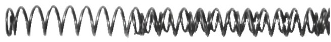

**Відповідь:** зворотні пружини 9-мм пістолету "ФОРТ-12"

### 249. На поданому малюнку зображено:

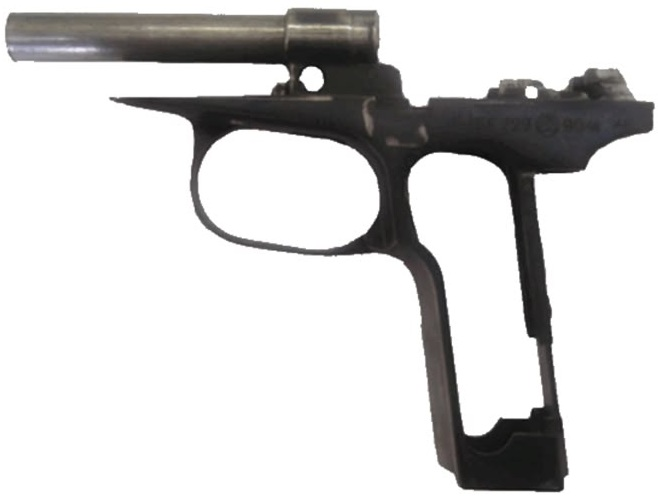

**Відповідь:** рамка зі стволом та спусковою скобою 9-мм пістолета "ПМ"

### 250. На поданому малюнку зображено:

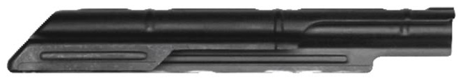

**Відповідь:** кришка ствольної коробки 7,62-мм автомата "АКМ"

### 251. На поданому малюнку зображено:

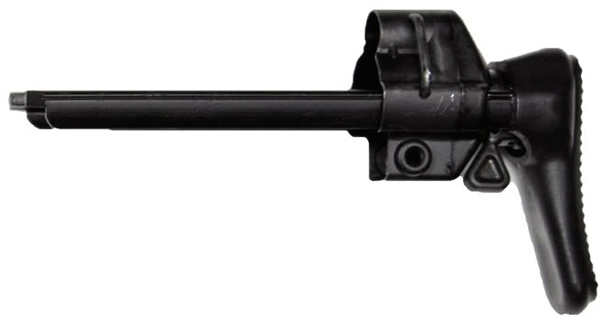

**Відповідь:** приклад розсувний 9-мм пістолет-кулемета "МР-5 А3"

### 252. На поданому малюнку зображено:

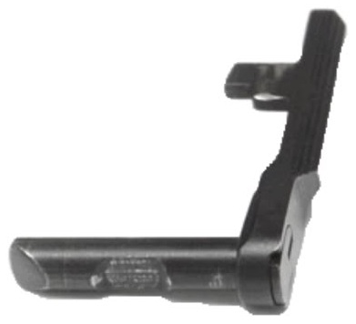

**Відповідь:** затворна затримка 9-мм пістолету "ФОРТ-12"

### 253. На поданому малюнку зображено:

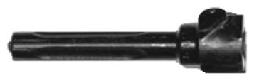

**Відповідь:** затвор 7,62-мм автомата "АКМ"

### 254. На поданому малюнку зображено:

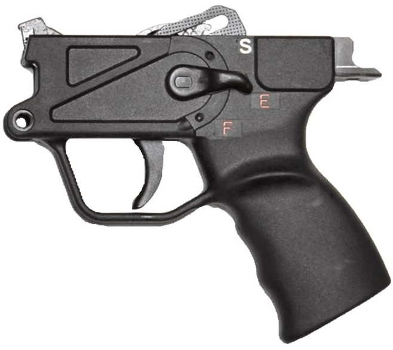

**Відповідь:** нижня частина ствольної коробки з блоком ударно-спускового механізму та рукояткою 9-мм пістолета-кулемета "МР-5 А3"

### 255. На поданому малюнку зображено:

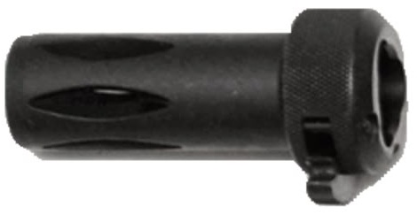

**Відповідь:** полум'ягасник 9-мм пістолета-кулемета "МР-5 А3"

### 256. На поданому малюнку зображено:

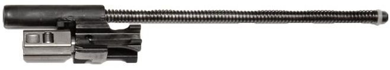

**Відповідь:** блок механізму затвору 9-мм пістолета-кулемета "МР-5 А3"

### 257. При виконанні вправи №1 яка дія після команди "Вогонь" виконується першою:

**Відповідь:** виймається зброя з кобури

### 258. На поданому малюнку зображено:

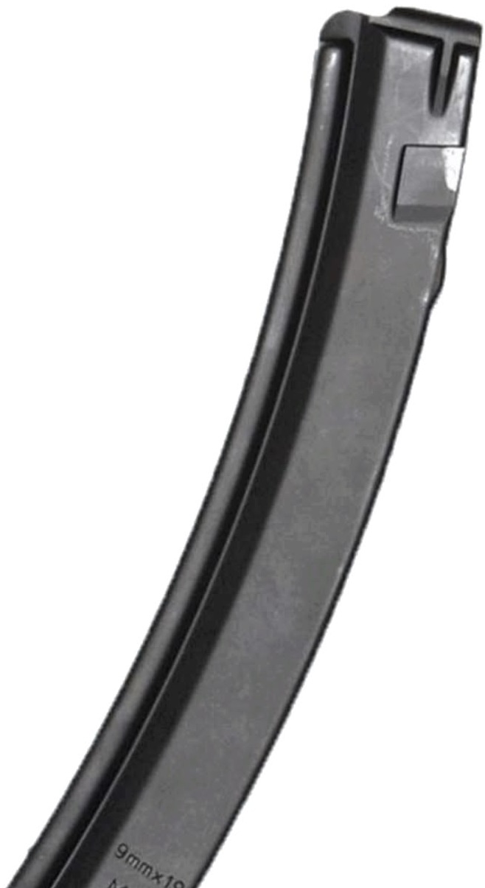

**Відповідь:** магазин 9-мм пістолета-кулемета "МР-5 А3"

### 259. На поданому малюнку зображено:

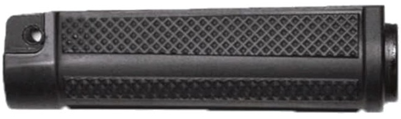

**Відповідь:** цівка 9-мм пістолета-кулемета "МР-5 А3"

### 260. На поданому малюнку зображено:

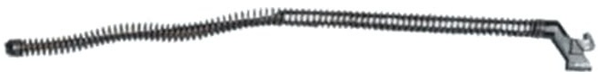

**Відповідь:** зворотний механізм 5,45-мм автомату "АКС-74У"

### 261. На поданому малюнку зображено:

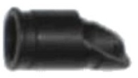

**Відповідь:** компенсатор 7,62-мм автомату "АКМ"

### 262. На поданому малюнку зображено:

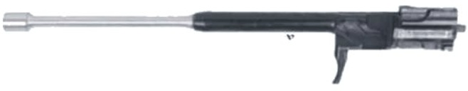

**Відповідь:** затворна рама з газовим поршнем 5,45-мм автомату "АКС-74У"

### 263. На поданому малюнку зображено:

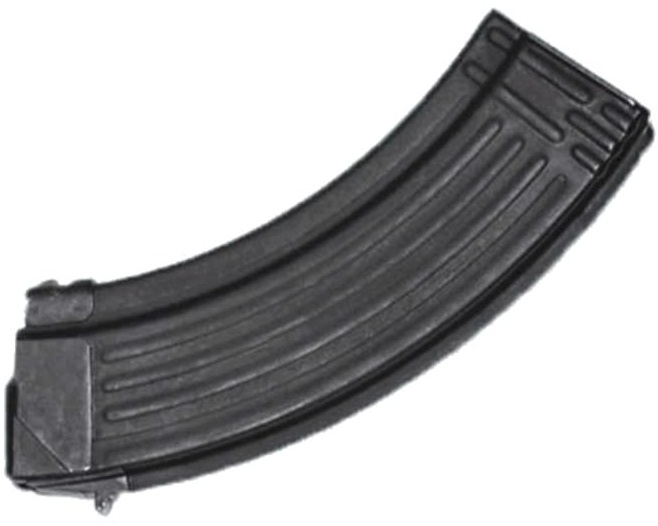

**Відповідь:** магазин 7,62-мм автомата "АКМ"

### 264. На поданому малюнку зображено:

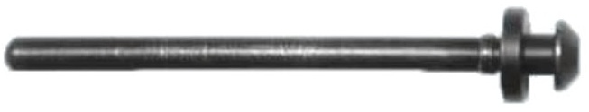

**Відповідь:** напрямна вісь 9-мм пістолету "ФОРТ-12"

### 265. На поданому малюнку зображено:

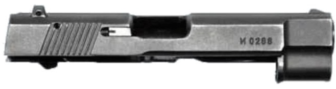

**Відповідь:** затвор з ударником, викидачем та запобіжником 9-мм пістолету "ФОРТ-12"

### 266. На поданому малюнку зображено:

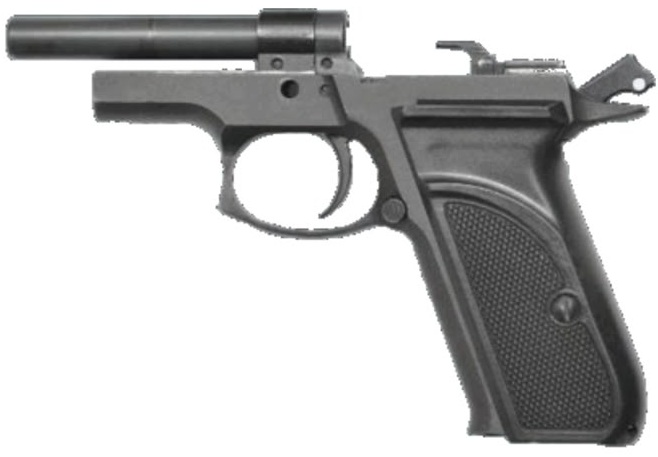

**Відповідь:** рамка в зборі зі стволом, рукояткою та ударно-спусковим механізмом 9-мм пістолету "ФОРТ-12"

### 267. На поданому малюнку зображено:

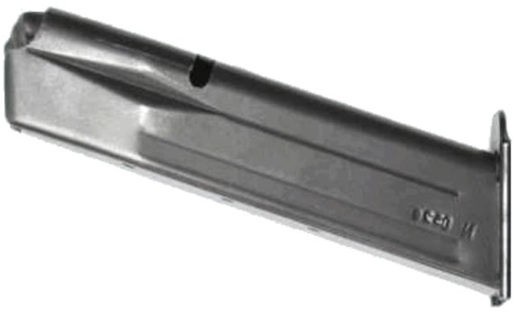

**Відповідь:** магазин 9-мм пістолету "ФОРТ-12"

### 268. На поданому малюнку зображено:

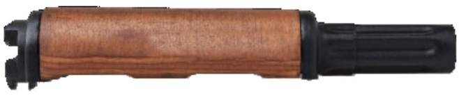

**Відповідь:** газова трубка зі ствольною накладкою 7,62-мм автомата "АКМ"

### 269. Яка частина зброї позначена на малюнку цифрою 1?

**Відповідь:** рамка

### 270. Яке призначення має частина зброї, що позначена на малюнку цифрою 1?

**Відповідь:** для приєднання всіх частин пістолета

### 271. Яка частина зброї позначена на малюнку цифрою 2?

**Відповідь:** ствол

### 272. Яке призначення має частина зброї, що позначена на малюнку цифрою 2?

**Відповідь:** для напряму польоту кулі й додання їй обертового руху

### 273. Яка частина зброї позначена на малюнку цифрою 3?

**Відповідь:** спускова скоба

### 274. Яке призначення має частина зброї, що позначена на малюнку цифрою 3?

**Відповідь:** для забезпечення безпеки при поводженні з пістолетом

### 275. Яка частина зброї позначена на малюнку цифрою 4?

**Відповідь:** затвор

### 276. Яке призначення має частина зброї, що позначена на малюнку цифрою 4?

**Відповідь:** для подачі патрона з магазина в патронник, запирання каналу ствола при пострілі, утримання гільзи (патрона) у чашечці затвора до зустрічі з відбивачем (викидання патрона) і постановки курка на бойовий взвод

### 277. Яка частина зброї позначена на малюнку цифрою 5?

**Відповідь:** запобіжник

### 278. Яке призначення має частина зброї, що позначена на малюнку цифрою 5?

**Відповідь:** для забезпечення безпеки при поводженні з пістолетом

### 279. Яка частина зброї позначена на малюнку цифрою 6?

**Відповідь:** зворотна пружина

### 280. Яке призначення має частина зброї, що позначена на малюнку цифрою 6?

**Відповідь:** для повернення затвора в переднє положення після пострілу

### 281. Яка частина зброї позначена на малюнку цифрою 7?

**Відповідь:** затворна затримка

### 282. Яке призначення має частина зброї, що позначена на малюнку цифрою 7?

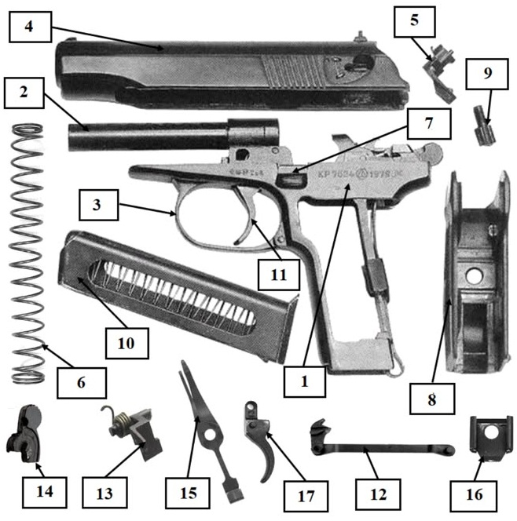

**Відповідь:** для тримання затвора в крайньому задньому положенні по використанню всіх патронів з магазина

### 283. Яка частина зброї позначена на малюнку цифрою 8?

**Відповідь:** рукоятка

### 284. Яке призначення має частина зброї, що позначена на малюнку цифрою 8?

**Відповідь:** для прикриття бічних вікон і задньої стінки основи рукоятки та для зручності тримання пістолета в руці

### 285. Яка частина зброї позначена на малюнку цифрою 9?

**Відповідь:** гвинт рукоятки

### 286. Яке призначення має частина зброї, що позначена на малюнку цифрою 9?

**Відповідь:** для кріплення рукоятки і засувки бойової пружини на основі рукоятки

### 287. Яка частина зброї позначена на малюнку цифрою 10?

**Відповідь:** магазин

### 288. Яке призначення має частина зброї, що позначена на малюнку цифрою 10?

**Відповідь:** для розміщення восьми патронів

### 289. Яка частина зброї позначена на малюнку цифрою 11?

**Відповідь:** спусковий гачок

### 290. Яке призначення має частина зброї, що позначена на малюнку цифрою 11?

**Відповідь:** для спуску курка з бойового взводу та постановки його на бойовий звід при стрільбі самозводом

### 291. Яка частина зброї позначена на малюнку цифрою 12?

**Відповідь:** спускова тяга з важелем взводу

### 292. Яке призначення має частина зброї, що позначена на малюнку цифрою 12?

**Відповідь:** для спуску курка з бойового взводу та постановки його на бойовий звід при натисканні на хвіст спускового гачка

### 293. Яка частина зброї позначена на малюнку цифрою 13?

**Відповідь:** шептало з пружиною

### 294. Яке призначення має частина зброї, що позначена на малюнку цифрою 13?

**Відповідь:** для утримання курка на бойовому та запобіжному взводі

### 295. Яка частина зброї позначена на малюнку цифрою 14?

**Відповідь:** курок

### 296. Яке призначення має частина зброї, що позначена на малюнку цифрою 14?

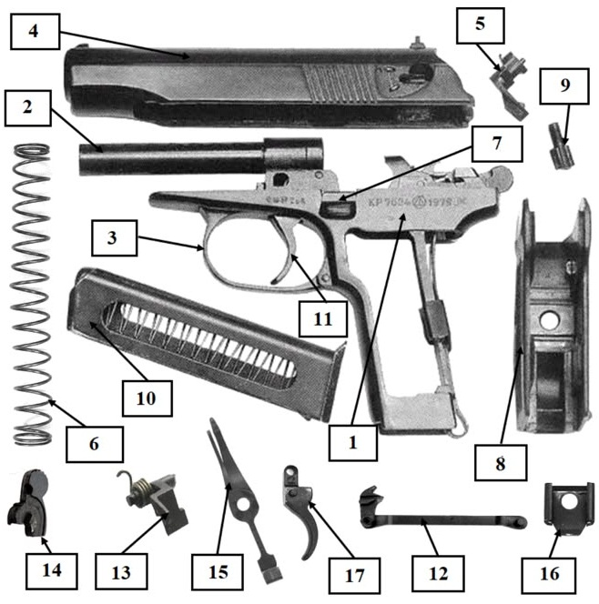

**Відповідь:** для нанесення удару по ударнику

### 297. Яка частина зброї позначена на малюнку цифрою 15?

**Відповідь:** бойова пружина

### 298. Яке призначення має частина зброї, що позначена на малюнку цифрою 15?

**Відповідь:** для приведення в дію курка, важеля взводу та спускової тяги

### 299. Яка частина зброї позначена на малюнку цифрою 16?

**Відповідь:** засувка бойової пружини

### 300. Яке призначення має частина зброї, що позначена на малюнку цифрою 16?

**Відповідь:** для кріплення бойової пружини до основи рукоятки

### 301. Яка частина зброї позначена на малюнку цифрою 17?

**Відповідь:** спусковий гачок

### 302. Яке призначення має частина зброї, що позначена на малюнку цифрою 17?

**Відповідь:** для спуску курка з бойового взводу та постановки його на бойовий звід при стрільбі самозводом

### 303. Яка частина пістолета Макарова зображена на малюнку?

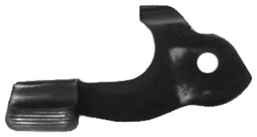

**Відповідь:** затворна затримка

### 304. Яка частина пістолета Макарова зображена на малюнку?

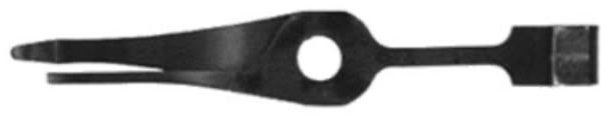

**Відповідь:** бойова пружина

### 305. Яка частина пістолета Макарова зображена на малюнку?

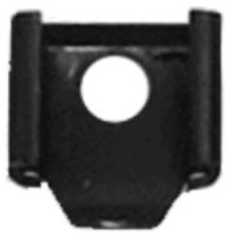

**Відповідь:** засувка бойової пружини

### 306. Яка частина пістолета Макарова зображена на малюнку?

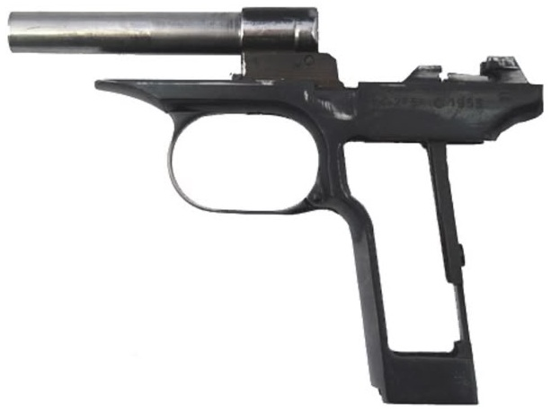

**Відповідь:** рамка зі стволом та спусковою скобою

### 307. Яка частина пістолета Макарова зображена на малюнку?

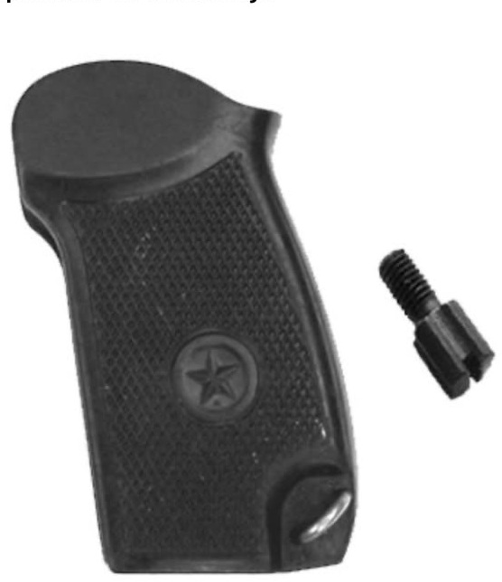

**Відповідь:** рукоятка з гвинтом

### 308. Яка частина пістолета Макарова зображена на малюнку?

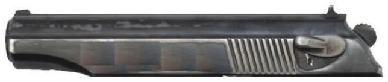

**Відповідь:** затвор з ударником, викидачем та запобіжником

### 309. Яке призначення має частина пістолета Макарова, зображена на малюнку?

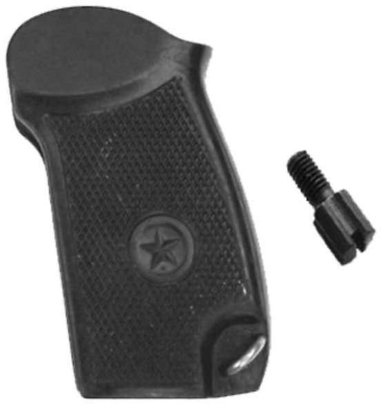

**Відповідь:** для прикриття бічних вікон і задньої стінки основи рукоятки та для зручності тримання пістолета в руці

### 310. Яке призначення має частина пістолета Макарова, зображена на малюнку?

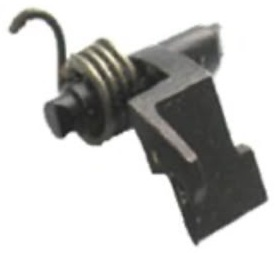

**Відповідь:** для утримання курка на бойовому та запобіжному взводі

### 311. Яке призначення має частина пістолета Макарова, зображена на малюнку?

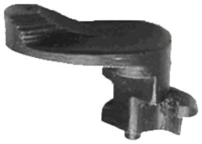

**Відповідь:** для забезпечення безпеки при поводженні з пістолетом

### 312. Яке призначення має частина пістолета Макарова, зображена на малюнку?

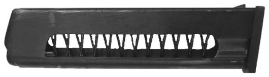

**Відповідь:** для розміщення восьми патронів

### 313. Яке призначення має частина пістолета Макарова, зображена на малюнку?

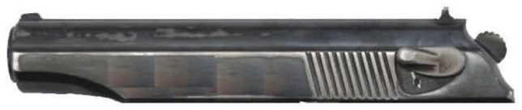

**Відповідь:** для подачі патрона з магазина в патронник, запирання каналу ствола при пострілі, утримання гільзи (патрона) у чашечці затвора до зустрічі з відбивачем (викидання патрона) і постановки курка на бойовий взвод

### 314. Яке призначення має частина пістолета Макарова, зображена на малюнку?

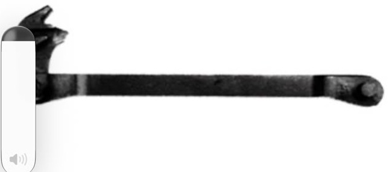

**Відповідь:** для спуску курка з бойового взводу та постановки його на бойовий звід при натисканні на хвіст спускового гачка

### 315. Яке призначення має частина пістолета Макарова, зображена на малюнку?

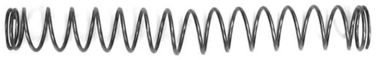

**Відповідь:** для повернення затвора в переднє положення після пострілу

### 316. Яке призначення має частина пістолета Макарова, зображена на малюнку?

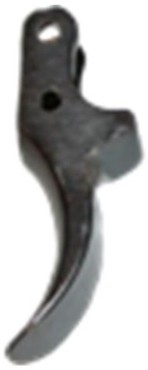

**Відповідь:** для спуска курка з бойового взводу й зведення курка при стрільбі самовзводом

### 317. Яка з тактико-технічних характеристик зброї притаманна пістолету Макарова?

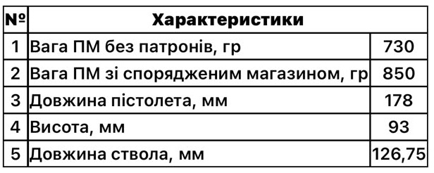

**Відповідь:** Варіант 1

### 318. Яка з тактико-технічних характеристик зброї притаманна пістолету Макарова?

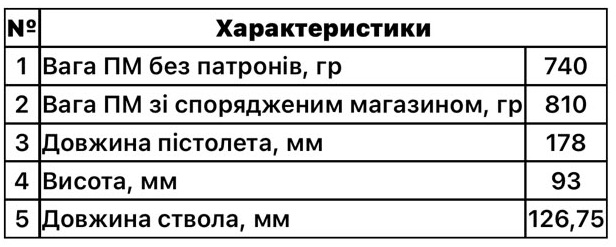

**Відповідь:** Варіант 2

### 319. Яка з тактико-технічних характеристик зброї притаманна пістолету Макарова?

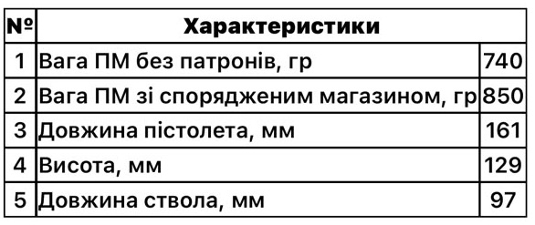

**Відповідь:** Варіант 3

### 320. Яка з тактико-технічних характеристик зброї притаманна пістолету Макарова?

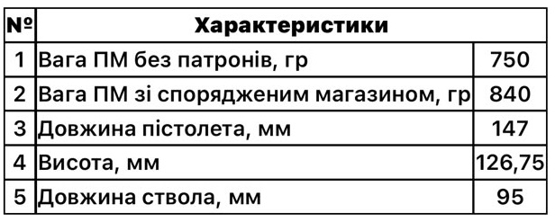

**Відповідь:** Варіант 4

### 321. Яка з тактико-технічних характеристик зброї притаманна пістолету Макарова?

**Відповідь:** Варіант 5

### 322. Яка з тактико-технічних характеристик зброї притаманна пістолету Макарова?

**Відповідь:** Варіант 5

### 323. Яка з тактико-технічних характеристик зброї притаманна пістолету Макарова?

**Відповідь:** Варіант 5

### 324. Яка з тактико-технічних характеристик зброї притаманна пістолету Макарова?

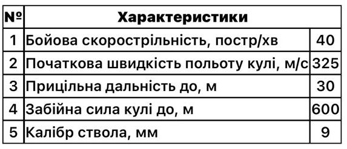

**Відповідь:** Варіант 5

### 325. Яка з тактико-технічних характеристик зброї притаманна пістолету Макарова?

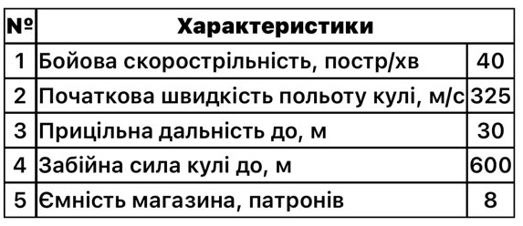

**Відповідь:** Варіант 5

### 326. Яка з тактико-технічних характеристик зброї притаманна пістолету Макарова?

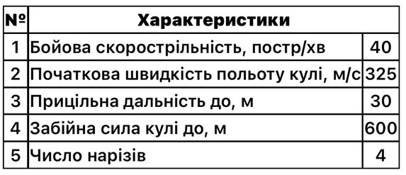

**Відповідь:** Варіант 5

### 327. Яка з тактико-технічних характеристик зброї притаманна пістолету Макарова?

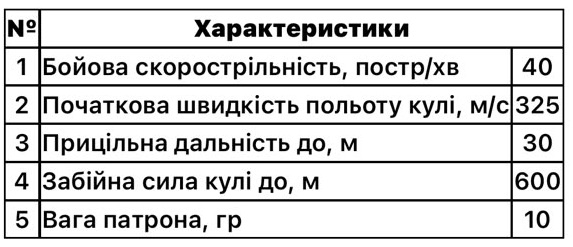

**Відповідь:** Варіант 5

### 328. Яка з тактико-технічних характеристик зброї притаманна пістолету Макарова?

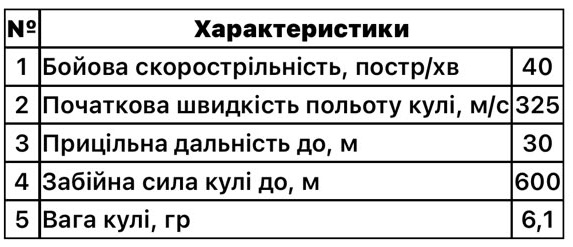

**Відповідь:** Варіант 5

### 329. Яка з тактико-технічних характеристик зброї притаманна пістолету Макарова?

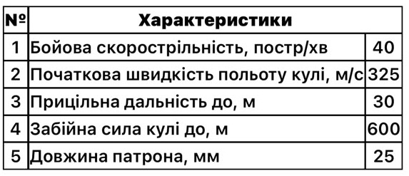

**Відповідь:** Варіант 5

### 330. Яка з тактико-технічних характеристик зброї притаманна пістолету Макарова?

**Відповідь:** Варіант 1

### 331. Яка з тактико-технічних характеристик зброї притаманна пістолету Макарова?

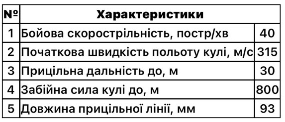

**Відповідь:** Варіант 2

### 332. Яка з тактико-технічних характеристик зброї притаманна пістолету Макарова?

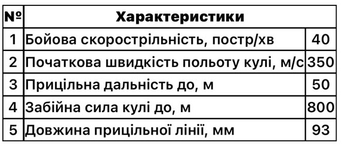

**Відповідь:** Варіант 3

### 333. Яка з тактико-технічних характеристик зброї притаманна пістолету Макарова?

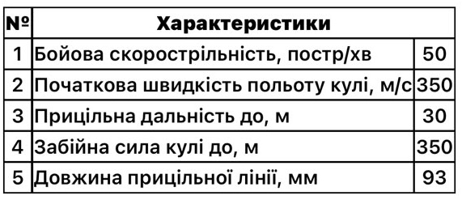

**Відповідь:** Варіант 4

### 334. Яка частина зброї позначена на малюнку цифрою 1?

**Відповідь:** рамка

### 335. Яке призначення має частина зброї, що позначена на малюнку цифрою 1?

**Відповідь:** для з'єднання всіх частин пістолета

### 336. Яка частина зброї позначена на малюнку цифрою 2?

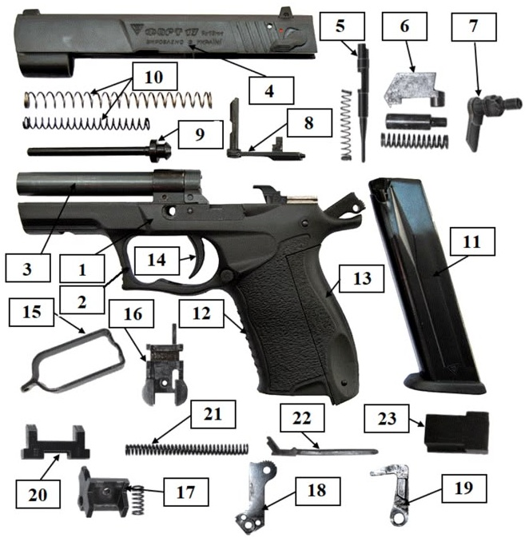

**Відповідь:** спускова скоба

### 337. Яке призначення має частина зброї, що позначена на малюнку цифрою 2?

**Відповідь:** для запобігання випадковому натисканню на спусковий гачок

### 338. Яка частина зброї позначена на малюнку цифрою 3?

**Відповідь:** ствол

### 339. Яке призначення має частина зброї, що позначена на малюнку цифрою 3?

**Відповідь:** для спрямування польоту кулі

### 340. Яка частина зброї позначена на малюнку цифрою 4?

**Відповідь:** затвор

### 341. Яке призначення має частина зброї, що позначена на малюнку цифрою 4?

**Відповідь:** для подачі патрона з магазина до патронника, замикання каналу ствола під час пострілу, тримання патрона (гільзи) в чашці затвора до зустрічі із відбивачем та для постановки курка на бойовий звід

### 342. Яка частина зброї позначена на малюнку цифрою 5?

**Відповідь:** ударник

### 343. Яке призначення має частина зброї, що позначена на малюнку цифрою 5?

**Відповідь:** для розбиття капсуля патрона

### 344. Яка частина зброї позначена на малюнку цифрою 6?

**Відповідь:** викидач

### 345. Яке призначення має частина зброї, що позначена на малюнку цифрою 6?

**Відповідь:** для тримання гільзи (патрона) в чашці затвора до зустрічі з відбивачем

### 346. Яка частина зброї позначена на малюнку цифрою 7?

**Відповідь:** запобіжник

### 347. Яке призначення має частина зброї, що позначена на малюнку цифрою 7?

**Відповідь:** для забезпечення безпеки при поводженні з пістолетом

### 348. Яка частина зброї позначена на малюнку цифрою 8?

**Відповідь:** затворна затримка

### 349. Яке призначення має частина зброї, що позначена на малюнку цифрою 8?

**Відповідь:** для тримання затвора в крайньому задньому положенні при використанні всіх патронів у магазині

### 350. Яка частина зброї позначена на малюнку цифрою 9?

**Відповідь:** напрямна вісь

### 351. Яке призначення має частина зброї, що позначена на малюнку цифрою 9?

**Відповідь:** для надання напрямного руху зворотним пружинам і затвору

### 352. Яка частина зброї позначена на малюнку цифрою 10?

**Відповідь:** зворотні пружини

### 353. Яке призначення має частина зброї, що позначена на малюнку цифрою 10?

**Відповідь:** для повернення в попереднє положення затвора після пострілу

### 354. Яка частина зброї позначена на малюнку цифрою 11?

**Відповідь:** магазин

### 355. Яке призначення має частина зброї, що позначена на малюнку цифрою 11?

**Відповідь:** для вміщення патронів

### 356. Яка частина зброї позначена на малюнку цифрою 12?

**Відповідь:** рукоятка

### 357. Яке призначення має частина зброї, що позначена на малюнку цифрою 12?

**Відповідь:** для зручного тримання пістолета у руці та прикривання бокових вікон

### 358. Яка частина зброї позначена на малюнку цифрою 13?

**Відповідь:** потиличник

### 359. Яке призначення має частина зброї, що позначена на малюнку цифрою 13?

**Відповідь:** для зручного тримання пістолета у руці та прикривання задньої стінки основи рукоятки

### 360. Яка частина зброї позначена на малюнку цифрою 14?

**Відповідь:** спусковий гачок

### 361. Яке призначення має частина зброї, що позначена на малюнку цифрою 14?

**Відповідь:** для спуску курка з бойового зводу та зведення його під час стрільби самозводом

### 362. Яка частина зброї позначена на малюнку цифрою 15?

**Відповідь:** спускова тяга

### 363. Яке призначення має частина зброї, що позначена на малюнку цифрою 15?

**Відповідь:** для спуску курка з бойового зводу та зведення його при натисканні на хвіст спускового гачка

### 364. Яка частина зброї позначена на малюнку цифрою 16?

**Відповідь:** корпус відбивача

### 365. Яке призначення має частина зброї, що позначена на малюнку цифрою 16?

**Відповідь:** для з'єднання шептала з пружиною, курка зі штифтом, тримання і спрямування руху роз'єднувача та штовхача

### 366. Яка частина зброї позначена на малюнку цифрою 17?

**Відповідь:** шептало

### 367. Яке призначення має частина зброї, що позначена на малюнку цифрою 17?

**Відповідь:** для тримання курка на бойовому та запобіжному зводі

### 368. Яка частина зброї позначена на малюнку цифрою 18?

**Відповідь:** курок

### 369. Яке призначення має частина зброї, що позначена на малюнку цифрою 18?

**Відповідь:** для нанесення удару по ударнику

### 370. Яка частина зброї позначена на малюнку цифрою 19?

**Відповідь:** штовхач

### 371. Яке призначення має частина зброї, що позначена на малюнку цифрою 19?

**Відповідь:** для зведення курка при стрільбі самозводом та для відведення назад спускової тяги під час зведення курка рукою або затвором

### 372. Яка частина зброї позначена на малюнку цифрою 20?

**Відповідь:** роз'єднувач

### 373. Яке призначення має частина зброї, що позначена на малюнку цифрою 20?

**Відповідь:** для роз'єднання спускової тяги з шепталом при відході затвора в заднє положення

### 374. Яка частина зброї позначена на малюнку цифрою 21?

**Відповідь:** бойова пружина

### 375. Яке призначення має частина зброї, що позначена на малюнку цифрою 21?

**Відповідь:** для приведення у дію важеля

### 376. Яка частина зброї позначена на малюнку цифрою 22?

**Відповідь:** важіль

### 377. Яке призначення має частина зброї, що позначена на малюнку цифрою 22?

**Відповідь:** спрямовує та передає зусилля від бойової пружини до курка

### 378. Яка частина зброї позначена на малюнку цифрою 23?

**Відповідь:** упор бойової пружини

### 379. Яке призначення має частина зброї, що позначена на малюнку цифрою 23?

**Відповідь:** спрямовує рух важеля

### 380. Яка частина пістолета Форт-17 зображена на малюнку?

**Відповідь:** зворотні пружини

### 381. Яка частина пістолета Форт-17 зображена на малюнку?

**Відповідь:** роз'єднувач

### 382. Яка частина пістолета Форт-17 зображена на малюнку?

**Відповідь:** запобіжник

### 383. Яка частина пістолета Форт-17 зображена на малюнку?

**Відповідь:** ударник

### 384. Яка частина пістолета Форт-17 зображена на малюнку?

**Відповідь:** важіль

### 385. Яка частина пістолета Форт-17 зображена на малюнку?

**Відповідь:** затвор

### 386. Яка частина пістолета Форт-17 зображена на малюнку?

**Відповідь:** корпус відбивача

### 387. Яка частина пістолета Форт-17 зображена на малюнку?

**Відповідь:** напрямна вісь

### 388. Яка частина пістолета Форт-17 зображена на малюнку?

**Відповідь:** викидач

### 389. Яке призначення має частина пістолета Форт-17, зображена на малюнку?

**Відповідь:** для нанесення удару по ударнику

### 390. Яке призначення має частина пістолета Форт-17, зображена на малюнку?

**Відповідь:** для тримання затвора в крайньому задньому положенні по використанню всіх патронів з магазина

### 391. Яке призначення має частина пістолета Форт-17, зображена на малюнку?

**Відповідь:** для тримання курка на бойовому та запобіжному зводі

### 392. Яке призначення має частина пістолета Форт-17, зображена на малюнку?

**Відповідь:** для тримання гільзи (патрона) в чашці затвора до зустрічі з відбивачем

### 393. Яке призначення має частина пістолета Форт-17, зображена на малюнку?

**Відповідь:** для приведення у дію важеля

### 394. Яке призначення має частина пістолета Форт-17, зображена на малюнку?

**Відповідь:** для з'єднання шептала з пружиною, курка зі штифтом, тримання і спрямування руху роз'єднувача та штовхача

### 395. Яка з тактико-технічних характеристик зброї притаманна пістолету Форт-17?

**Відповідь:** Варіант 1

### 396. Яка з тактико-технічних характеристик зброї притаманна пістолету Форт-17?

**Відповідь:** Варіант 2

### 397. Яка з тактико-технічних характеристик зброї притаманна пістолету Форт-17?

**Відповідь:** Варіант 3

### 398. Яка з тактико-технічних характеристик зброї притаманна пістолету Форт-17?

**Відповідь:** Варіант 4

### 399. Яка з тактико-технічних характеристик зброї притаманна пістолету Форт-17?

**Відповідь:** Варіант 5

### 400. Яка з тактико-технічних характеристик зброї притаманна пістолету Форт-17?

**Відповідь:** Варіант 5

### 401. Яка з тактико-технічних характеристик зброї притаманна пістолету Форт-17?

**Відповідь:** Варіант 5

### 402. Яка з тактико-технічних характеристик зброї притаманна пістолету Форт-17?

**Відповідь:** Варіант 2

### 403. Яка з тактико-технічних характеристик зброї притаманна пістолету Форт-17?

**Відповідь:** Варіант 4

### 404. Яка з тактико-технічних характеристик зброї притаманна пістолету Форт-17?

**Відповідь:** Варіант 4

### 405. Яка з тактико-технічних характеристик зброї притаманна пістолету Форт-17?

**Відповідь:** Варіант 5

### 406. Яка з тактико-технічних характеристик зброї притаманна пістолету Форт-17?

**Відповідь:** Варіант 3

### 407. Яка з тактико-технічних характеристик зброї притаманна пістолету Форт-17?

**Відповідь:** Варіант 3

### 408. Яка частина зброї позначена на малюнку цифрою 1?

**Відповідь:** ствол

### 409. Яке призначення має частина зброї, що позначена на малюнку цифрою 1?

**Відповідь:** для спрямування польоту кулі

### 410. Яка частина зброї позначена на малюнку цифрою 2?

**Відповідь:** затвор

### 411. Яке призначення має частина зброї, що позначена на малюнку цифрою 2?

**Відповідь:** для досилання патрону у патронник, запирання каналу ствола, розбивання капсуля і викидання з патронника гільзи патрона

### 412. Яка частина зброї позначена на малюнку цифрою 3?

**Відповідь:** затворна рама з газовим поршнем

### 413. Яке призначення має частина зброї, що позначена на малюнку цифрою 3?

**Відповідь:** для приведення в дію затвора та ударно-спускового механізму

### 414. Яка частина зброї позначена на малюнку цифрою 4?

**Відповідь:** кришка ствольної коробки

### 415. Яке призначення має частина зброї, що позначена на малюнку цифрою 4?

**Відповідь:** для запобігання забрудненню частин і механізмів, розміщених у ствольній коробці

### 416. Яка частина зброї позначена на малюнку цифрою 5?

**Відповідь:** зворотний механізм

### 417. Яке призначення має частина зброї, що позначена на малюнку цифрою 5?

**Відповідь:** для повернення затворної рами із затвором в попереднє положення

### 418. Яка частина зброї позначена на малюнку цифрою 6?

**Відповідь:** газова трубка зі ствольною накладкою

### 419. Яке призначення має частина зброї, що позначена на малюнку цифрою 6?

**Відповідь:** для спрямування газового поршня і для захисту рук від опіків при стрільбі

### 420. Яка частина зброї позначена на малюнку цифрою 7?

**Відповідь:** цівка

### 421. Яке призначення має частина зброї, що позначена на малюнку цифрою 7?

**Відповідь:** для зручності дії з автоматом і захисту рук від опіків

### 422. Яка частина зброї позначена на малюнку цифрою 8?

**Відповідь:** магазин

### 423. Яке призначення має частина зброї, що позначена на малюнку цифрою 8?

**Відповідь:** для розміщення патронів і подачі їх у ствольну коробку

### 424. Яка частина зброї позначена на малюнку цифрою 9?

**Відповідь:** полум'ягасник

### 425. Яке призначення має частина зброї, що позначена на малюнку цифрою 9?

**Відповідь:** для зменшення віддачі

### 426. Яка частина зброї позначена на малюнку цифрою 10?

**Відповідь:** ствольна коробка

### 427. Яке призначення має частина зброї, що позначена на малюнку цифрою 10?

**Відповідь:** з'єднує частини і механізми автомата, забезпечує закривання каналу ствола затвором і запирання затвора

### 428. Яка частина зброї позначена на малюнку цифрою 11?

**Відповідь:** пістолетна рукоятка

### 429. Яке призначення має частина зброї, що позначена на малюнку цифрою 11?

**Відповідь:** для забезпечення зручності дії з автоматом при стрільбі

### 430. Яка частина зброї позначена на малюнку цифрою 12?

**Відповідь:** приклад, що складається

### 431. Яке призначення має частина зброї, що позначена на малюнку цифрою 12?

**Відповідь:** для забезпечення зручності дії з автоматом при стрільбі

### 432. Яка частина зброї позначена на малюнку цифрою 13?

**Відповідь:** прицільний пристрій

### 433. Яке призначення має частина зброї, що позначена на малюнку цифрою 13?

**Відповідь:** для наведення автомата при стрільбі по цілях на різні відстані

### 434. Яка частина зброї позначена на малюнку цифрою 14?

**Відповідь:** пружина шептала одиночного вогню

### 435. Яка частина зброї позначена на малюнку цифрою 15?

**Відповідь:** автоспуск

### 436. Яка частина зброї позначена на малюнку цифрою 16?

**Відповідь:** уповільнювач курка

### 437. Яка частина зброї позначена на малюнку цифрою 17?

**Відповідь:** курок

### 438. Яка частина зброї позначена на малюнку цифрою 18?

**Відповідь:** бойова пружина

### 439. Яка частина зброї позначена на малюнку цифрою 19?

**Відповідь:** шептало одиночного вогню

### 440. Яка частина зброї позначена на малюнку цифрою 20?

**Відповідь:** пружина уповільнювача курка

### 441. Яка частина зброї позначена на малюнку цифрою 21?

**Відповідь:** пружина автоспуска

### 442. Яка частина зброї позначена на малюнку цифрою 22?

**Відповідь:** перевідник

### 443. Яка частина зброї позначена на малюнку цифрою 23?

**Відповідь:** спусковий гачок

### 444. Яка частина зброї позначена на малюнку цифрою 24?

**Відповідь:** вісь

### 445. Яка з тактико-технічних характеристик зброї притаманна АКС-74У?

**Відповідь:** Варіант 1

### 446. Яка з тактико-технічних характеристик зброї притаманна АКС-74У?

**Відповідь:** Варіант 2

### 447. Яка з тактико-технічних характеристик зброї притаманна АКС-74У?

**Відповідь:** Варіант 3

### 448. Яка з тактико-технічних характеристик зброї притаманна АКС-74У?

**Відповідь:** Варіант 4

### 449. Яка з тактико-технічних характеристик зброї притаманна АКС-74У?

**Відповідь:** Варіант 4

### 450. Яка з тактико-технічних характеристик зброї притаманна АКС-74У?

**Відповідь:** Варіант 1

### 451. Яка з тактико-технічних характеристик зброї притаманна АКС-74У?

**Відповідь:** Варіант 2

### 452. Яка з тактико-технічних характеристик зброї притаманна АКС-74У?

**Відповідь:** Варіант 3

### 453. Яка з тактико-технічних характеристик зброї притаманна АКС-74У?

**Відповідь:** Варіант 1

### 454. Яка з тактико-технічних характеристик зброї притаманна АКС-74У?

**Відповідь:** Варіант 1

### 455. Яка з тактико-технічних характеристик зброї притаманна АКС-74У?

**Відповідь:** Варіант 4

### 456. Яка з тактико-технічних характеристик зброї притаманна АКС-74У?

**Відповідь:** Варіант 1

### 457. Яка з тактико-технічних характеристик зброї притаманна АКС-74У?

**Відповідь:** Варіант 5

### 458. Яка з тактико-технічних характеристик зброї притаманна АКС-74У?

**Відповідь:** Варіант 5

